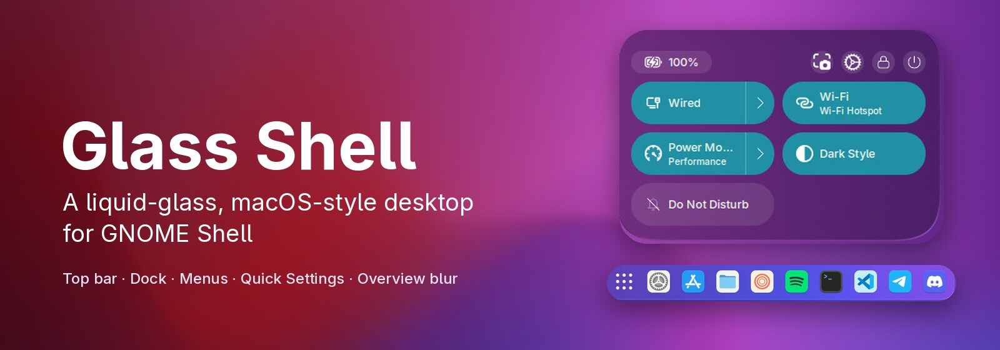
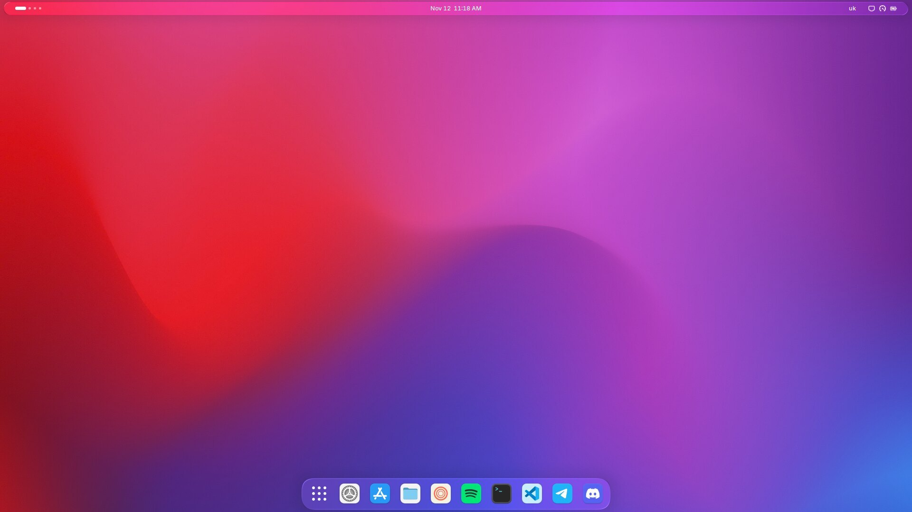
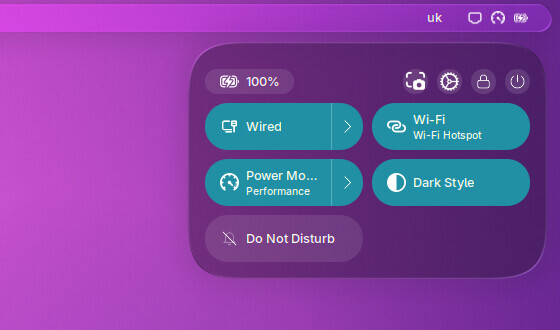
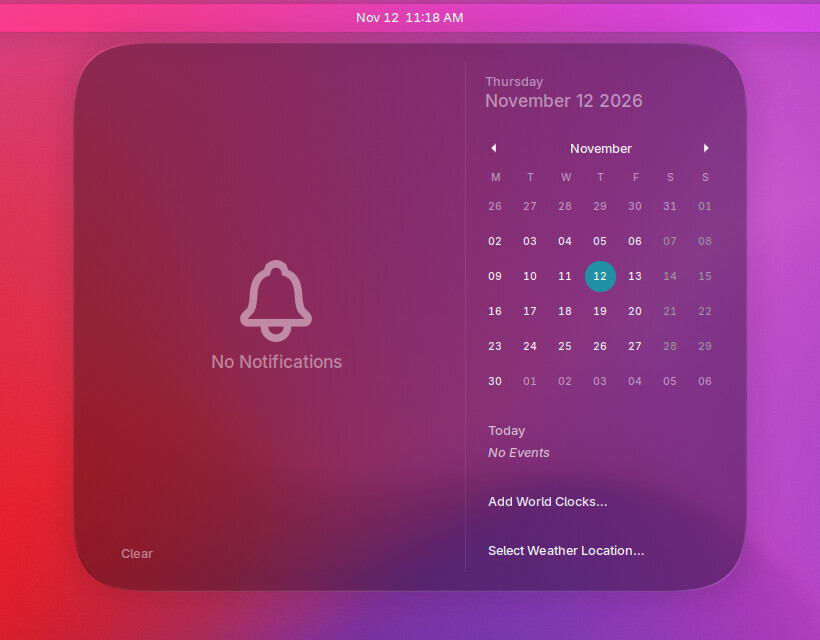
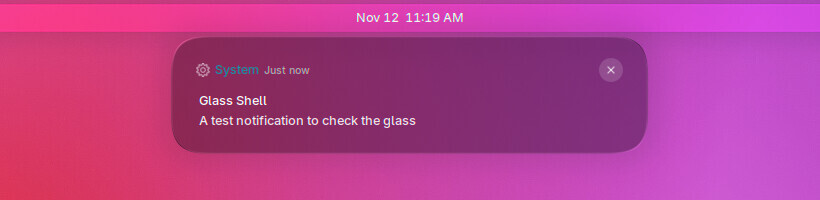
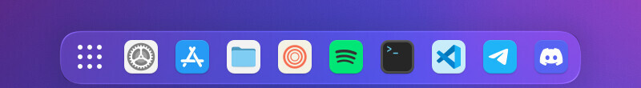
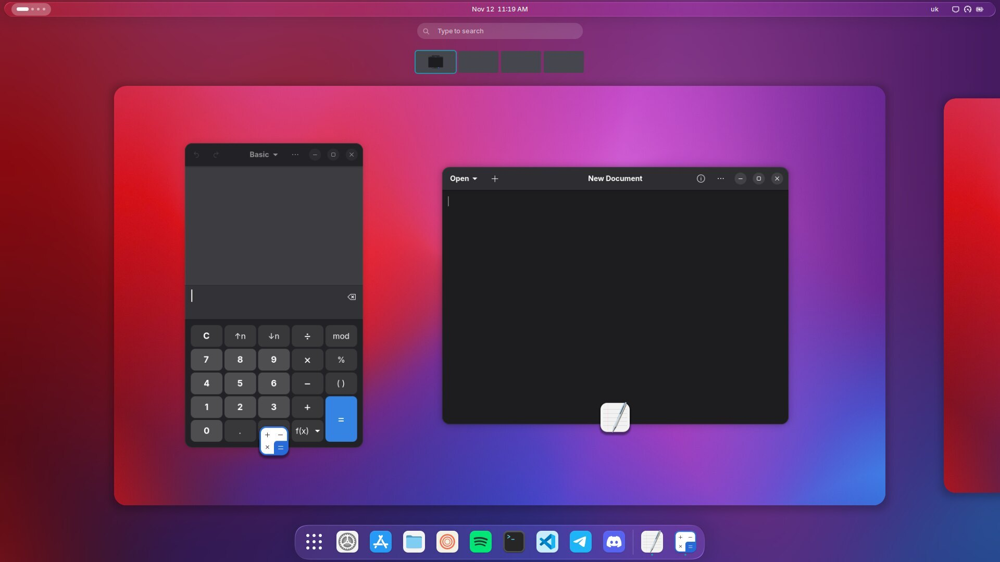
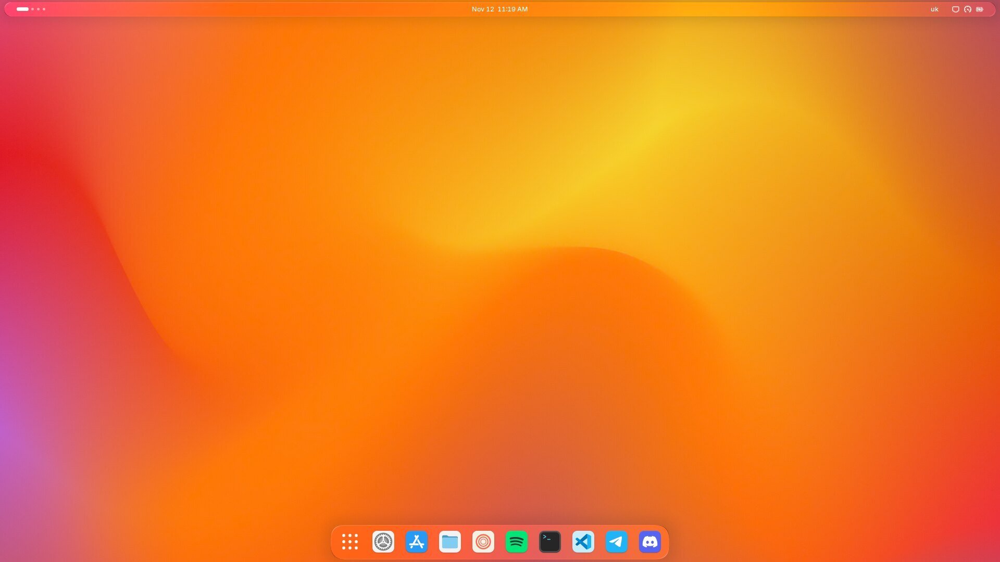
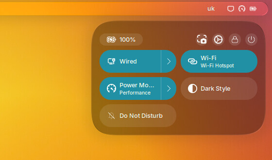
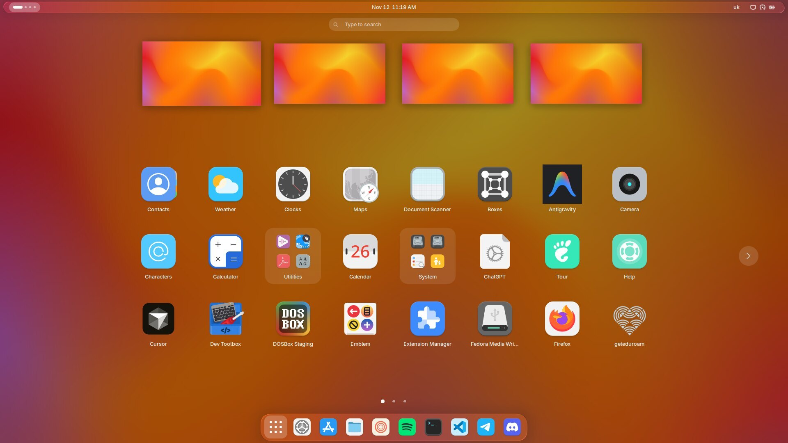

<p align="center">
  
</p>

<p align="center">
  <a href="#install"></a>
  <a href="LICENSE"></a>
  
</p>

**Glass Shell** is a GNOME Shell extension that turns the shell into a minimal, macOS-like desktop
made of glass: a floating glass top bar, its own bottom dock, glass menus, Quick Settings and
notifications, and a blurred overview, all on a compact, scalable shell theme. It is one extension;
you do not need Dash to Dock, Blur my Shell or a user theme on top of it.

<p align="center">
  
</p>

## Features

- **Liquid glass** on the top bar, its menus, Quick Settings, the calendar, notifications and the
  volume / brightness OSDs: blur, tint, refraction and a light rim, drawn by the Liquid Glass engine.
- **Its own dock** at the bottom: pinned and running apps, an accent-coloured running dot, and macOS-style clicks.
  - Click a running app to focus it. Click it again to minimise it.
  - Click an app with several windows to get live previews of each window.
  - Middle click or Ctrl+click opens a new window.
  - Smart hiding: the dock moves away when a window covers it. It can also always hide or never hide.
  - Minimised windows shrink into their dock icon.
- **Blurred overview and app grid** on every monitor, like Blur my Shell.
- **Blurred lock screen wallpaper on every monitor.** GNOME's own lock screen leaves one monitor
  black on some two-monitor setups; Glass Shell paints it itself.
- **A compact shell theme** built from GNOME's own, scaled with one setting. There are presets from
  *Tiny* (0.7) to *Extra large* (1.2). Sizes are rounded to whole pixels, so text stays sharp.
- **Light and dark.** The shell stays dark with white text by default, even in Light style, or it
  follows the system Dark Style switch.
- **Wallpaper pairs.** Put `NAME-light.jpg` / `NAME-dark.jpg` in the `wallpapers` folder and the
  wallpaper changes together with Dark Style.
- **Performance mode.** It turns all glass and blur off and gives every surface a solid background.
  - It is on automatically while the power profile is *Power Saver*.
  - You can also set it to *always on* or *off*.
- **macOS-style controls** (from Aura Glass): capsule sliders, rounded menus, notification cards.

## Screenshots

| Quick Settings | Calendar and notifications |
|---|---|
|  |  |
| **Notification** | **Dock** |
|  |  |

<p align="center">
  
  <br><em>The overview over a blurred wallpaper</em>
</p>

<details>
<summary><b>Light style</b> (system in Light style, shell kept dark)</summary>
<br>



</details>

## Requirements

| | |
|---|---|
| **GNOME Shell** | 47 – 51. Tested on GNOME 51 (Fedora 45), Wayland. |
| **Needed** | `glib2` (for `glib-compile-schemas`). Fedora, Ubuntu and Arch ship it with GNOME. |
| **Optional** | `power-profiles-daemon`, for the automatic performance mode (Fedora and Ubuntu have it by default). |
| **Optional** | GNOME Weather, for the weather in the desktop widgets (not used by default). |
| **Only to rebuild the engine** | Node.js and npm, to compile `src/*.ts` into `dist/` (the built `dist/` is in the repository). |

No other extension is needed. **Turn these off**, because Glass Shell already draws what they draw:

- Dash to Dock / Dash to Panel / Ubuntu Dock;
- Blur my Shell;
- Just Perfection;
- User Themes (a shell theme);
- Liquid Glass and Aura Glass themselves.

## Install

```bash
git clone https://github.com/mzslav/glass-shell.git
cd glass-shell
./install.sh
```

`install.sh` compiles the settings schema, links `glass-shell@mzslav` into
`~/.local/share/gnome-shell/extensions/` and enables it. **Log out and back in** afterwards:
on Wayland GNOME Shell cannot reload extensions while it runs.

Because the extension is linked, not copied, a `git pull` followed by a re-login is all an
update needs. Run `./install.sh` again when the settings schema changed.

To remove it: `./uninstall.sh`, or `./uninstall.sh --reset` to delete its settings too.

## Settings

Open **Extensions → Glass Shell → Settings**, or run `gnome-extensions prefs glass-shell@mzslav`.
The **Appearance** page has the Glass Shell group:

| Setting | What it does |
|---|---|
| Performance mode | Automatic (with Power Saver), always on, or off |
| Interface size | Size of the top bar, menus and Quick Settings; presets or an exact scale |
| Glass Shell dock | The dock, its icon size, Show Apps button position and hiding |
| Shell in Light style | Keep the shell dark (white text) or follow the system |
| Blur behind overview | Overview blur, its radius and brightness |
| Wallpaper | Which `NAME-light` / `NAME-dark` pair from the wallpapers folder to use |

The other pages (**Effects**, **Desktop**, **Rendering**) hold the glass engine's settings: the tint,
blur and corner radius of every surface, and the optional desktop clock and widgets.

From a terminal:

```bash
S="gsettings --schemadir $HOME/.local/share/gnome-shell/extensions/glass-shell@mzslav/schemas"
$S set org.gnome.shell.extensions.glass-shell ui-scale 0.85
$S set org.gnome.shell.extensions.glass-shell dock-autohide "'intellihide'"   # intellihide | autohide | off
$S set org.gnome.shell.extensions.glass-shell performance-mode "'auto'"      # auto | on | off
```

## Wallpapers

The wallpapers folder is `~/.local/share/gnome-shell/extensions/glass-shell@mzslav/wallpapers/`;
**Settings → Wallpaper → Open folder** opens it. Put pairs of pictures there:

```
mountains-light.jpg    used in Light style
mountains-dark.jpg     used in Dark style
```

Choose the pair in **Settings → Wallpaper**. The repository ships no pictures. The ones in
`/usr/share/backgrounds/gnome/` (`NAME-l` / `NAME-d`) are a good start: copy them in and rename them.

## Customising

| I want to change | Where |
|---|---|
| Default settings | `glass-shell@mzslav/schemas/*.gschema.xml`, then `./install.sh` |
| How the dock looks | `styles/dock.css` |
| How the dock behaves | `custom/glassDock.js`, `custom/dockIntellihide.js`, `custom/dockPreviews.js` |
| Sliders, switches, menus, notifications | `styles/macos.css`, `styles/theme-overrides.css` |
| Light style colours | `styles/macos-light.css`; glass tints in `custom/themeMode.js` |
| Performance mode surfaces | `styles/solid.css`, `styles/solid-light.css` |
| The glass itself (shaders, managers) | `src/*.ts`, then `npm install && npm run build` in `glass-shell@mzslav/` |

### Project layout

```
glass-shell@mzslav/
  extension.js        entry point: starts the glass engine and the Glass Shell parts
  custom/             Glass Shell parts: dock, theme builder, light/dark, wallpapers,
                      overview and lock screen blur, performance mode, dev tools
  styles/             CSS layered on GNOME's shell theme
  src/  dist/         the Liquid Glass engine (TypeScript sources and the built JS)
  shaders/            GLSL for the glass
  preferences/        the settings window
  schemas/            settings and their defaults
  wallpapers/         your NAME-light / NAME-dark pictures (not in git)
tools/preview.sh      screenshots from a throwaway headless GNOME Shell
```

### Checking a change without logging out

```bash
tools/preview.sh /tmp/shots desktop quick-settings calendar overview apps
PREVIEW_SCHEME=light PREVIEW_WALLPAPER=amber tools/preview.sh /tmp/shots desktop lock
```

This starts a separate, invisible GNOME Shell with its own settings. It enables only Glass Shell
and saves screenshots; your session is not touched. The screenshots in this README were made this
way. The script turns on the `dev-tools` setting inside that throwaway shell only. Keep
`dev-tools` off in your own session: while it is on, any program in the session can take
screenshots through it.

The tests in `tests/` come from Liquid Glass (`npm install`, then `node --test tests/`). They have
not been updated for the Glass Shell changes.

## Troubleshooting

- **Nothing changed after installing or updating.** Log out and back in.
- **Two docks, or a theme on top of the theme.** Turn off the extensions listed under
  [Requirements](#requirements).
- **The desktop feels slow.** Set performance mode to *Always on*. If you want to keep the glass,
  set `glass-blur-downscale` to 4 or turn the glass off on single surfaces under **Effects**.
- **Errors:** `journalctl --user -b -g "Glass Shell"`.

## Credits and license

[MIT](LICENSE). Glass Shell is built on:

- [**Liquid Glass**](https://github.com/ryohsuke1231/liquid-glass) by Ryosuke Watanabe (MIT).
  The whole glass engine comes from it. Its original README is in
  [`docs/UPSTREAM-liquid-glass-README.md`](docs/UPSTREAM-liquid-glass-README.md).
- [**Aura Glass**](https://github.com/DevWebeloper/aura-glass) (MIT), for the macOS-style controls in `styles/macos.css`.
- Fonts in `glass-shell@mzslav/fonts/` (Antonio, Barlow Condensed, Saira Extra Condensed,
  Sofia Sans Extra Condensed) are under the SIL Open Font License; see the `*-OFL.txt` files.
- The wallpaper in the screenshots is *Amber* from GNOME's backgrounds (CC BY-SA 3.0).

Glass Shell is not affiliated with Apple or the GNOME Foundation.
